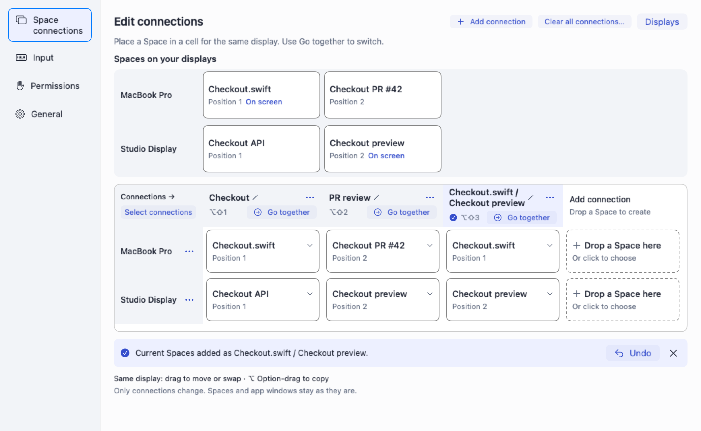
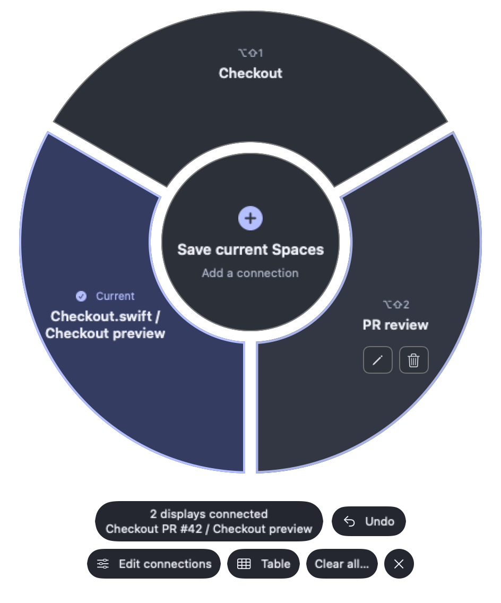
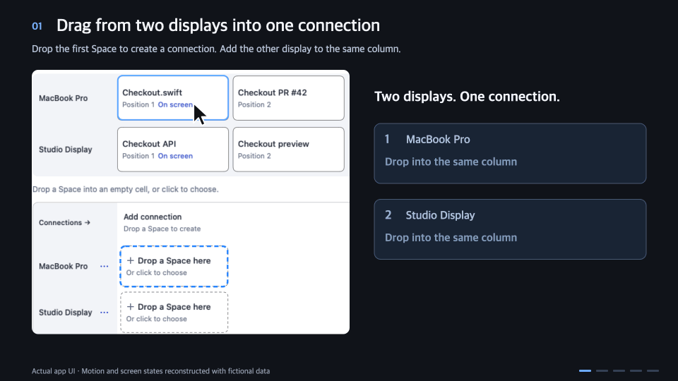

# Sideby

English | [한국어](README.ko.md)

[Website](https://ethznn.github.io/sideby/) · [Download](https://github.com/ethznn/sideby/releases/latest)

**Move your Spaces together.**

Connect the Spaces you already use across your displays. When your environment changes, see what is open and adjust the matching cell in Settings. No names or separate saves are required.

<p align="center">
  
</p>

*22.5-second motion graphic with fictional data. Illustrated workflow, not an app capture or a switching benchmark.*

[Still image](docs/images/sideby-connections-film-en.png) · [Preview with playback controls](https://ethznn.github.io/sideby/#film)

*Sideby 1.1.2 · [What’s new](docs/releases/1.1.2.md).*

## See and connect in one window

<p align="center">
  
</p>

*Actual app view with fictional data.*

1. Open **Sideby in the menu bar → Settings**. It opens directly to **Space connections**.
2. Review the Spaces above the table. Available app/window titles, Space order, totals for each display, and **On screen** markers show what is open.
3. Drag a Space into an empty cell for the same display to make your first connection. You can also click a Space, then a cell. Changes are remembered immediately. Use **Undo** or `⌘Z` to step back through the last 20 changes, including after restarting Sideby.

Spaces in the same column switch together. You can also click a cell to choose directly.

- **Create a connection:** Drop a Space into a blank cell in the **Add connection** column. This creates a new connection. Then drag a Space from another display into its row in that same column. The + button scrolls to the blank column.
- **Move or swap:** Drag between cells for the same display. Move into an empty cell or swap two occupied cells.
- **Copy:** **Hold ⌥ Option when dropping** to keep the source cell. Dragging from the Space list also keeps the list intact.
- **Undo:** **Undo** restores both cells in one step.

To clear one cell, click it and choose **Disconnect this cell**. Use **… → Clear connections for this display…** beside a display name to clear just that row. Connections for disconnected displays can also be cleared; other displays' connections are kept. Use a column heading's **…** or right-click menu to reorder or remove a column.

To remove several columns together, choose **Select connections** at the table's top left. Click headings or cells to select their columns, then choose **Remove N selected…** and confirm for multiple connections. A single selected connection is removed immediately. You can also **Select all**. **Cancel** leaves your connections unchanged and exits selection mode. One **Undo** restores the removed columns together. Clicking cells in selection mode does not edit connections or switch Spaces.

To start over, choose **Clear all connections…** and confirm. This also clears connections for disconnected displays. The actual Spaces and app windows stay open. Empty cells remain available so you can immediately create a new connection. If you change your mind while rebuilding, use **Undo** repeatedly to go back. Clearing all connections counts as one of the last 20 changes.

Click **Go together** below a column heading to move your screens. Filled cards show connected Spaces; dashed **+** cells are available for a connection. Use **Add connection** to reveal the blank column, or the **…** menu to reorder or remove a connection. Editing a cell or dragging a desktop does not switch screens. Displays excluded from switching remain where they are.

## Get started

1. Download the DMG from [GitHub Releases](https://github.com/ethznn/sideby/releases), move Sideby to Applications, and open it.
2. Allow Accessibility and Screen Switching access in the guide.
3. Choose Spaces in the empty cells to make a connection. You can also choose **Pair by order** to pair Spaces at the same positions across selected displays. Naming, saving, and switching practice are not required.

Existing connections, names, and numbered shortcuts are kept. No recreation or deletion is required. If you have an unsaved draft in an older editor, finish it before changing connections here.

## Daily use

Hold **⌥⇧Space** to open the quick switcher near your pointer. Use **Circle** or **Table** above it to choose your view; the control stays in the same position, and Sideby remembers your choice. Click a connection to move its Spaces together. The circular menu stays inside the screen, with transparent gaps and no rectangular backdrop. Up to eight connections appear per page.

Drag a connection in the circular menu to change its order. This keeps its Space assignments and numbered shortcut, and does not switch screens. **Undo** restores the previous order.

Hover over a connection to preview its Spaces in the center. Hover over the center to reveal **Add current setup**, then click to keep the Spaces you are looking at as one connection. Names such as **Xcode / Figma** are filled in automatically. An existing identical connection is shown instead of duplicated. With no connections yet, the center offers the same action with guidance for creating your first connection.

For three or more displays, the center grows to show each connected display's contents. The menu keeps its size while you hover between connections. If the available screen area is too small, Sideby opens the table view. Very short switches skip the connection-name HUD; longer switches use a gentle fade.

<p align="center">
  
</p>

<p align="center">
  
</p>

*28-second usage guide: drag to connect, connect current Spaces, switch while coding, swap, undo, Option-copy, rename, return, delete, and undo. Sideby 1.1.0 UI with fictional data and reconstructed actions. The current app also includes the center hover previews, Circle/Table control, and circular-menu reordering described above.*

[Play with controls](https://ethznn.github.io/sideby/#tutorial) · [Still image](docs/images/sideby-tutorial-en.png)

Hover over a connection to reveal its **pencil** and **trash** buttons. The name and sector switch Spaces; only the pencil renames. **Apply** saves the name, **Cancel** keeps it, and **Undo** restores it after applying. Removing one connection is immediate, without a confirmation dialog. Actual Spaces and app windows stay open. **Undo** remains visible and restores the connection, assignments, and shortcut, even after deleting the last connection or reopening Sideby.

Choose **Edit connections** for the Space list and connection table. Drag within the same display row to move or swap; hold Option when dropping to copy. The Circle/Table control is hidden while editing; **Back to switching** returns to your previous view. **Clear all…** asks for confirmation before clearing all connections; the center remains ready to create a new one.

| Input | Action |
| --- | --- |
| Hold `⌥⇧Space` | Open the last-used Circle or Table view near the pointer. Click a connection to move together. |
| `⌥⇧Tab` | Return to the last connection you visited. |
| `⌥⇧1` … `⌥⇧9`, `⌥⇧0` | Move to the connection assigned that number. Deleting another connection keeps existing numbers. |
| `⌥⇧<` / `⌥⇧>` | Move to the previous / next connection. |
| Option + Shift + horizontal swipe | Move displays together with the default gesture. |

Numbered, previous/next, and return shortcuts execute when Option and Shift are released. Releasing the opening shortcut closes the quick switcher without switching or saving anything by itself. Changing views, reordering, saving, renaming, removing, or choosing an editor keeps it open. Release the shortcut before editing, then press Option again while dropping a Space to copy. Use Tab to focus controls, Return/Space to activate, and Escape to close. Configure inputs in **Settings → Input**.

## When your environment changes

Connections follow the same surviving desktops when their order changes. A missing desktop is marked **Choose again**; Sideby never substitutes another desktop at the same position. New desktops appear in the upper list for you to connect. Disconnected displays keep their connections; use **Show disconnected displays** to see them.

**Space** refers to a macOS workspace, including regular desktops and full-screen apps. **Space 3** means its position in that display’s list, not a Mission Control name such as “Desktop 3.” Available app/window names are shown first.

In the quick switcher’s **Edit connections** view, clearing connections and creating them again keeps the heading, Space list, and drop targets in place. Space choices stay inside the screen. If a saved Space is missing, use **Choose Space again** to pick another or **Disconnect this cell** to remove its assignment. You can also Option-drag another cell from the same display to copy it, then undo the change if needed.

While the connection editor is visible, Space lists and available app/window titles update automatically. If Spaces cannot be read, use **Read again** after checking the display connection. Custom desktop names take priority. These labels do not rename Mission Control desktops. If writing settings fails, Sideby reports the problem and keeps the existing connections.

Sideby connects and switches existing Spaces. It does not create or delete desktops, launch apps, put them into full screen, or restore window positions.

## Privacy and platform notes

Sideby uses Accessibility for its configured global gesture and available app/window title suggestions. Screen Switching access allows the requested desktop-switch commands; some paths also need System Events Automation. Switching and desktop discovery do not request Screen Recording permission.

Setup names, desktop connection bookmarks, custom desktop names, display choices, shortcut assignments, undo data, migration backups, input preferences, and guide progress stay locally on your Mac. Runtime numeric Space IDs, window IDs, raw input events, and screenshots are not saved. Sideby does not save typed input from its global shortcut handling.

The direct-distribution app uses private SkyLight APIs with App Sandbox off. Updates use Sparkle 2, with user-approved installation. The update window follows your selected app language after Sideby is reopened; release notes are in English.

## Development

Open `Package.swift` in Xcode with a Swift 6 toolchain, or run:

```bash
swift test
swift build --product SidebyApp
swift build --product SidebyDevApp
```

`SidebyApp` is the product; `SidebyDevApp` is a local probe. Before a local app bundle build, read the published [Sparkle feed](https://github.com/ethznn/sideby/releases/latest/download/appcast.xml) and set `SIDEBY_BUILD_NUMBER` to the latest `sparkle:version` plus one when running `scripts/build_app_bundle.sh`.

See [Development](docs/DEVELOPMENT.md), [Decisions](docs/DECISIONS.md), and [README media](docs/media/README.md). Native documentation views use isolated sample data. The repository contains GIF previews and still images; full MP4 exports stay local.

## Contributing, security, and license

Read [CONTRIBUTING.md](CONTRIBUTING.md) before opening an issue or pull request. Report vulnerabilities through [SECURITY.md](SECURITY.md). Sideby is released under the [MIT License](LICENSE).
